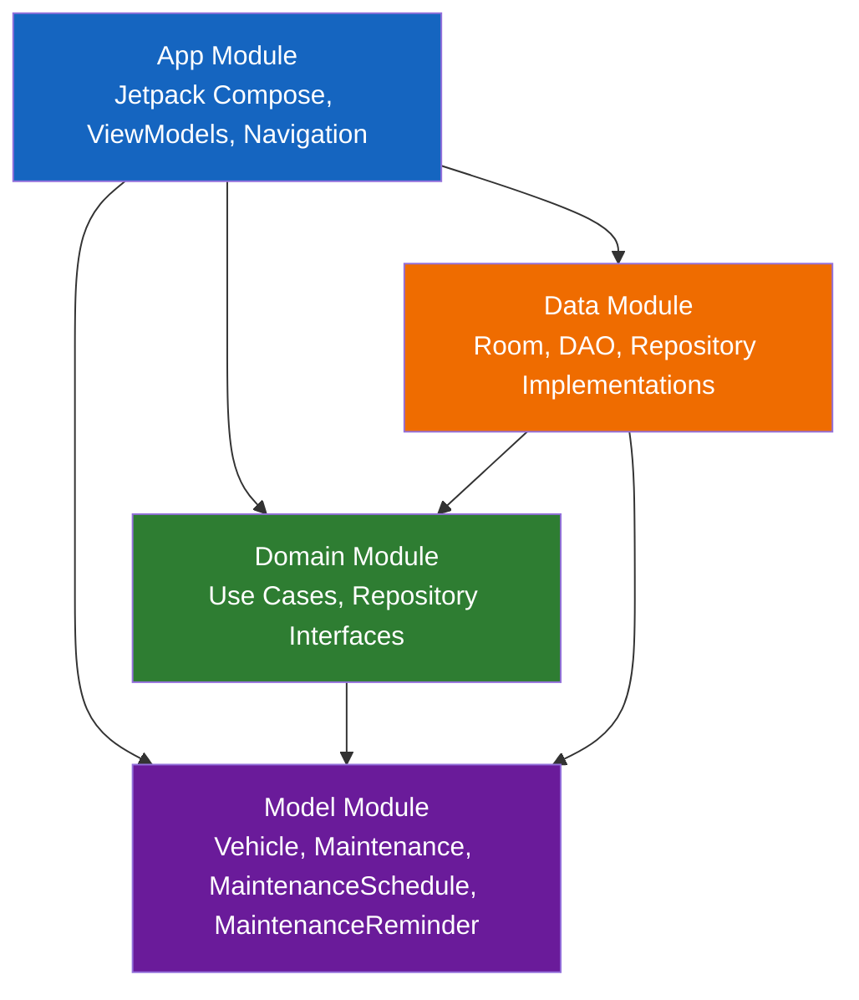
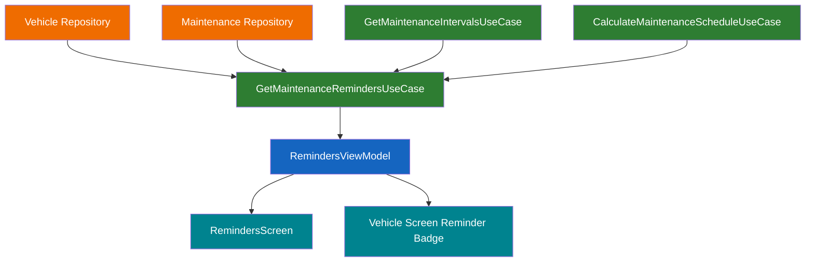

# 🚗 CarCare-AI

[](https://github.com/Firas2094/CarCare-AI/actions/workflows/android-ci.yml)

### Modern Android Vehicle Maintenance Application

CarCare-AI is a native Android application designed to help users manage their vehicles, track maintenance operations, monitor maintenance expenses, and anticipate upcoming service requirements.

Built with Kotlin, Jetpack Compose, Room, and a modular Clean Architecture approach, this project demonstrates modern Android development practices, separation of concerns, reactive programming, and maintainable application design.

The project is actively evolving, with AI-powered features planned for future releases.

## ✨ Features

### 🚘 Vehicle Management

- Add and manage multiple vehicles.
- Edit and delete vehicle information.
- Track mileage and vehicle specifications.
- Support different fuel types.
- Manage vehicle license plate information.

### 🔧 Maintenance Tracking

- Record vehicle maintenance operations.
- Track maintenance dates, mileage, and costs.
- Store garage information and maintenance notes.
- Edit and delete maintenance records.
- View maintenance history for each vehicle.

### 📅 Maintenance Scheduling

- Calculate upcoming maintenance deadlines.
- Track remaining kilometers and days.
- Identify maintenance status: OK, SOON, OVERDUE, or UNKNOWN.
- Support mileage-based and date-based maintenance intervals.
- Configure custom maintenance intervals for each vehicle.
- Automatically calculate maintenance requirements based on vehicle mileage and maintenance history.

### 📊 Maintenance Statistics Dashboard

- View maintenance statistics for each vehicle.
- Track total maintenance expenses and average maintenance costs.
- Analyze monthly maintenance spending.
- Visualize expenses grouped by maintenance type.
- Automatically update statistics when maintenance records change using Kotlin Flow.
- Exclude maintenance records without a cost from financial calculations.
- Calculate statistics through a dedicated domain use case.

### 🔔 Maintenance Reminders Center

- Centralized maintenance reminders for all registered vehicles.
- Display overdue and upcoming maintenance reminders.
- Dynamic reminder count badge on the vehicle list screen.
- Display separate counters for overdue and upcoming maintenance.
- Group reminders by maintenance status.
- Prioritize overdue maintenance reminders.
- Display remaining or overdue kilometers and days.
- Automatically recalculate reminders when vehicle mileage, maintenance history, or custom intervals change.
- Navigate directly to the corresponding vehicle maintenance screen.
- Handle empty reminder states.
- Reactive reminder management using Kotlin Flow and a dedicated domain use case.

### 📲 Background Notifications

- Background reminder scheduling using WorkManager.
- Android notification integration.
- Notification permission handling for Android 13+.
- Prevent duplicate maintenance notifications.
- Navigate directly to vehicle maintenance information from notifications.

### 💾 Offline-First Experience

- Local persistence using Room Database.
- Vehicle and maintenance information available offline.
- Reactive data management with Kotlin Flow.
- Database migrations preserving existing user data.

## 🛠️ Tech Stack

| Category | Technologies |
|---|---|
| Language | Kotlin |
| UI | Jetpack Compose, Material Design 3 |
| Architecture | Clean Architecture, MVVM |
| Asynchronous Programming | Kotlin Coroutines, Flow, StateFlow |
| Local Database | Room |
| Background Processing | WorkManager |
| Navigation | Jetpack Navigation Compose |
| Dependency Management | Gradle Kotlin DSL, Version Catalog |
| Dependency Injection | Manual DI using AppContainer |
| State Management | ViewModel |
| Unit Testing | JUnit |
| CI/CD | GitHub Actions |
| Version Control | Git, GitHub |

## 🏗️ Architecture

CarCare-AI follows a modular Clean Architecture approach,
separating presentation, business logic, data management,
and domain models.



### Architecture Responsibilities

- App: UI components, navigation, ViewModels, notifications, background tasks, and dependency configuration.
- Domain: Business logic, repository contracts, maintenance calculations, statistics, and reminder use cases.
- Data: Room database, DAO implementations, entity mapping, database migrations, and repositories.
- Model: Core business models shared across application layers.

This modular structure promotes maintainability,
testability, scalability, and separation of concerns.

### Reactive Data Flow

CarCare-AI uses Kotlin Flow to observe changes in local data
and automatically update the user interface.


This reactive approach ensures that maintenance schedules,
financial statistics, and maintenance reminders are updated
when their underlying data changes.

### Maintenance Reminders Architecture

The maintenance reminders center uses a dedicated domain
use case to observe maintenance requirements across all
registered vehicles.



The reminder center reuses existing maintenance calculation
rules without introducing additional database tables or
duplicating business logic.

## 🧪 Testing and Quality Assurance

CarCare-AI combines automated testing, continuous integration,
and manual functional validation.

### Automated Testing

- Unit tests for maintenance statistics business logic.
- Validation of maintenance expense calculations.
- Validation of monthly expense aggregation.
- Validation of maintenance category aggregation.
- Validation of maintenance records without associated costs.

### Functional Validation

- Vehicle management workflows.
- Maintenance management workflows.
- Maintenance statistics dashboard.
- Maintenance reminders center.
- Reactive reminder updates after mileage modifications.
- Reminder updates after maintenance operations.
- Reminder removal after vehicle deletion.
- Navigation and empty-state handling.

Functional testing is performed on Android emulators
and physical Android devices.

## ⚙️ Continuous Integration

The project uses GitHub Actions to automatically validate
code changes.

The Android CI pipeline includes:

- Repository checkout.
- Java 17 environment configuration.
- Android build environment setup.
- Android application compilation.
- Unit test execution.
- Pull request validation.

The main branch is protected by required CI checks,
ensuring that code changes pass automated validation
before being merged.

## 🚀 Project Roadmap

CarCare-AI is an actively developed Android application.

The current development phase focuses on building a robust
business layer, reliable vehicle maintenance management,
and advanced maintenance analysis before introducing
AI-powered capabilities.

### ✅ Implemented Features

- Vehicle management (create, read, update, delete).
- Maintenance history and tracking.
- Maintenance expense and garage information tracking.
- Maintenance scheduling based on mileage and dates.
- Custom maintenance intervals.
- Local persistence using Room Database.
- Database migrations.
- Modular Clean Architecture.
- Reactive state management with ViewModel.
- Background maintenance reminders using WorkManager.
- Vehicle maintenance statistics dashboard.
- Monthly maintenance expense analysis.
- Expense breakdown by maintenance category.
- Reactive statistics updates using Kotlin Flow.
- Unit tests for maintenance statistics business logic.
- Centralized maintenance reminders center.
- Dynamic maintenance reminder badge.
- Overdue and upcoming maintenance counters.
- Reactive cross-vehicle maintenance monitoring.
- Automatic reminder updates based on maintenance data changes.
- Continuous integration using GitHub Actions.

### 🔄 Current Development Priorities

- Advanced maintenance history filtering and sorting.
- Improving business rules and maintenance calculations.
- Strengthening application stability and error handling.
- Improving notification reliability.
- Expanding automated test coverage where relevant.
- Preparing the application for future AI integration.

### 📅 Planned Features

- Advanced maintenance history filtering and sorting.
- PDF export of vehicle maintenance history.
- Advanced vehicle maintenance statistics.
- Maintenance cost trends and financial analytics.
- Vehicle maintenance budget tracking.
- Vehicle information import using license plates.
- AI-powered vehicle maintenance recommendations.
- Intelligent maintenance predictions.
- AI-assisted vehicle maintenance insights.
- Complete UI/UX redesign using Jetpack Compose.
- Material Design 3 interface improvements.
- Improved accessibility and user experience.

### 🎨 UI/UX Development Strategy

The current user interface is a functional first version.

Development currently prioritizes business logic,
application architecture, and feature reliability.

A complete UI/UX redesign is planned once the core
business functionalities reach sufficient maturity.

The objective is to deliver an application that combines
robust engineering with a modern, accessible,
and intuitive user experience.

## 📱 Screenshots

Application screenshots will be added after the planned
UI/UX redesign.

## 🚀 Getting Started

### Prerequisites

- Android Studio
- Android SDK
- JDK 17 or a compatible JDK supported by the project's Gradle configuration

### Installation

Clone the repository:

```bash
git clone https://github.com/Firas2094/CarCare-AI.git
```

Open the project in Android Studio, synchronize Gradle,
and run the `app` configuration on an emulator or
compatible Android device.

### Build the Application

Linux / macOS:

```bash
./gradlew assembleDebug
```

Windows:

```powershell
.\gradlew.bat assembleDebug
```

### Run Unit Tests

Linux / macOS:

```bash
./gradlew testDebugUnitTest :domain:test
```

Windows:

```powershell
.\gradlew.bat testDebugUnitTest :domain:test
```

## 🧠 Roadmap Checklist

### Completed Features

- [x] Vehicle management
- [x] Maintenance management
- [x] Local Room persistence
- [x] Modular Clean Architecture
- [x] Maintenance schedule calculations
- [x] Custom maintenance intervals
- [x] Background reminder implementation
- [x] Maintenance expense tracking
- [x] Maintenance statistics dashboard
- [x] Monthly maintenance expense analysis
- [x] Maintenance category expense breakdown
- [x] Maintenance statistics unit tests
- [x] Centralized maintenance reminders center
- [x] Dynamic maintenance reminder badge
- [x] Reactive maintenance reminder updates
- [x] GitHub Actions continuous integration

### Upcoming Features

- [ ] Advanced maintenance history filtering
- [ ] Maintenance history sorting
- [ ] PDF export of maintenance history
- [ ] Advanced financial analytics
- [ ] Interactive expense charts
- [ ] Maintenance cost trends
- [ ] Year-over-year expense comparisons
- [ ] Vehicle maintenance budget tracking
- [ ] Vehicle information import using license plates
- [ ] AI-assisted maintenance recommendations
- [ ] Intelligent maintenance predictions
- [ ] Intelligent vehicle maintenance insights
- [ ] Improved notification experience
- [ ] Expanded automated test coverage
- [ ] Complete UI/UX redesign
- [ ] Accessibility improvements
- [ ] Application screenshots

## 🎯 Project Goals

CarCare-AI is a personal engineering project focused on:

- Applying modern Android development practices.
- Building maintainable and scalable application architecture.
- Exploring advanced Kotlin and Jetpack Compose capabilities.
- Implementing reactive and offline-first mobile applications.
- Developing reliable maintenance management business logic.
- Applying automated testing and continuous integration.
- Integrating AI into practical mobile applications.
- Continuously improving code quality and software design.

## 👨‍💻 Author

Firas Hamouda Boughzou

Senior Android Developer | Kotlin | Jetpack Compose | Clean Architecture

GitHub: [Firas2094](https://github.com/Firas2094)

---

CarCare-AI — Built with Kotlin and Jetpack Compose.
