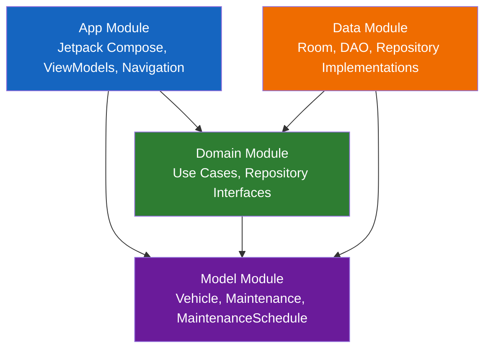

# 🚗 CarCare-AI

### Modern Android Vehicle Maintenance Application

CarCare-AI is a native Android application designed to help users manage their vehicles, track maintenance operations, and anticipate upcoming service requirements.

Built with Kotlin, Jetpack Compose, Room, and a modular Clean Architecture approach, this project demonstrates modern Android development practices, separation of concerns, and maintainable application design.

The project is actively evolving, with AI-powered features planned for future releases.

## ✨ Features

### 🚘 Vehicle Management
- Add and manage multiple vehicles.
- Edit and delete vehicle information.
- Track mileage and vehicle specifications.
- Support different fuel types.

### 🔧 Maintenance Tracking
- Record vehicle maintenance operations.
- Track maintenance dates, mileage, and costs.
- Edit and delete maintenance records.
- View maintenance history for each vehicle.

### 📅 Maintenance Scheduling
- Calculate upcoming maintenance deadlines.
- Track remaining kilometers and days.
- Identify maintenance status: OK, SOON, OVERDUE, or UNKNOWN.
- Support mileage-based and date-based maintenance intervals.

### 🔔 Maintenance Reminders
- Background reminder scheduling using WorkManager.
- Android notification integration.
- Notification permission handling for Android 13+.

### 💾 Offline-First Experience
- Local persistence using Room Database.
- Vehicle and maintenance information available offline.
- Reactive data management with Kotlin Flow.

## 🛠️ Tech Stack

| Category | Technologies |
|---|---|
| Language | Kotlin |
| UI | Jetpack Compose, Material Design |
| Architecture | Clean Architecture, MVVM |
| Asynchronous Programming | Kotlin Coroutines, Flow |
| Local Database | Room |
| Background Processing | WorkManager |
| Navigation | Jetpack Navigation Compose |
| Dependency Management | Gradle Kotlin DSL |
| Dependency Injection | Manual DI using AppContainer |
| State Management | ViewModel |

## 🏗️ Architecture

CarCare-AI follows a modular Clean Architecture approach,
separating presentation, business logic, data management,
and domain models.



### Architecture Overview

- App: UI components, navigation, ViewModels and background tasks.
- Domain: Business logic, use cases and repository contracts.
- Data: Local persistence with Room, DAOs and repository implementations.
- Model: Core business entities and maintenance scheduling models.

This modular structure improves maintainability, testability
and separation of concerns.

### Architecture Responsibilities

- App: UI components, navigation, ViewModels, notifications, and dependency configuration.
- Domain: Business logic, repository contracts, and use cases.
- Data: Room database, DAO implementations, entity mapping, and repositories.
- Model: Core business models shared across application layers.

This separation promotes testability, maintainability, and scalability.

## 🚀 Project Roadmap

CarCare-AI is an actively developed Android application.

The current development phase focuses on building a robust
business layer and reliable vehicle maintenance management.

### ✅ Implemented Features

- Vehicle management (create, read, update, delete).
- Maintenance history and tracking.
- Maintenance scheduling based on mileage and dates.
- Local persistence using Room Database.
- Modular Clean Architecture.
- Reactive state management with ViewModel.
- Background maintenance reminders using WorkManager.

### 🔄 Current Development Priorities

- Improving business rules and maintenance calculations.
- Strengthening application stability and error handling.
- Expanding unit test coverage.
- Improving notification reliability.

### 📅 Planned Features

- Complete UI/UX redesign using Jetpack Compose.
- Material Design 3 interface improvements.
- AI-powered vehicle maintenance recommendations.
- Intelligent maintenance predictions.
- Advanced vehicle maintenance statistics.
- Improved accessibility and user experience.

### 🎨 UI/UX Development Strategy

The current user interface is a functional first version.

Development currently prioritizes business logic,
application architecture, and feature reliability.

A complete UI/UX redesign is planned once the core
business functionalities reach sufficient maturity.

The objective is to deliver an application that combines
robust engineering with a modern and intuitive user experience.

## 📱 Screenshots

Application screenshots will be added in an upcoming update.

## 🚀 Getting Started

### Prerequisites

- Android Studio
- Android SDK
- JDK compatible with the project's Gradle configuration

### Installation

Clone the repository:

```bash
git clone https://github.com/Firas2094/CarCare-AI.git
```

Open the project in Android Studio, synchronize Gradle, and run the `app` configuration on an emulator or compatible Android device.

## 🧠 Roadmap

### Current Development
- [x] Vehicle management
- [x] Maintenance management
- [x] Local Room persistence
- [x] Modular architecture
- [x] Maintenance schedule calculations
- [x] Background reminder implementation

### Planned Improvements
- [ ] AI-assisted maintenance recommendations
- [ ] Intelligent vehicle maintenance insights
- [ ] Improved notification experience
- [ ] Expanded automated test coverage
- [ ] UI/UX enhancements

## 🎯 Project Goals

CarCare-AI is a personal engineering project focused on:

- Applying modern Android development practices.
- Building maintainable and scalable application architecture.
- Exploring advanced Kotlin and Jetpack Compose capabilities.
- Integrating AI into practical mobile applications.
- Continuously improving code quality and software design.

## 👨‍💻 Author

Firas Hamouda Boughzou

Senior Android Developer | Kotlin | Jetpack Compose | Clean Architecture

GitHub: Firas2094

---

CarCare-AI — Built with Kotlin and Jetpack Compose.
